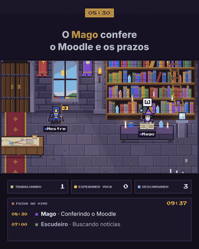

# Sala do QG · demonstração

Um castelo em pixel art que mostra, ao vivo, o que cada um dos meus agentes de IA está fazendo.

**[Abrir a demonstração](index.html)** · um dia inteiro do QG em cerca de um minuto, com atividades de exemplo.

## A ideia

O QG Central é uma família de quatro agentes de IA que conversam comigo num grupo do Telegram e dividem a mesma memória:

| Agente | Papel | Estação no castelo |
|---|---|---|
| Mestre das Rotas | Lê cada mensagem e chama o agente certo | Mesa de mapas, na porta |
| Escudeiro do Dia a Dia | Notícias e ajuda geral | Mural de pergaminhos |
| Mago dos Estudos | Faculdade, prazos e Moodle | Biblioteca |
| Guerreiro do Trabalho | Tarefas do estágio | Mesa de guerra |

Faltava enxergar o que eles estão fazendo. A Sala do QG é esse painel: cada agente vai até a sua estação quando trabalha, volta para a taverna quando termina, e avisa com um "!" quando precisa de mim. Quando o Mestre chama alguém, uma linha dourada liga os dois e a rota acende no mapa.

## O que você vê na tela

- **Contadores:** quantos agentes estão trabalhando, esperando você ou descansando.
- **Faixa ao vivo:** o que aconteceu nas últimas horas.
- **Cartão:** passe o mouse (ou toque) num agente para ver o estado atual e o histórico recente.
- **Hora real:** o céu das janelas e a luz do salão acompanham a hora de São Paulo, então à noite o castelo escurece e aparecem estrelas.

## Privacidade por desenho

A versão de verdade roda ao vivo, protegida por chave, e recebe só rótulos de uma lista fixa ("Buscando notícias", "Conferindo o Moodle", "Esperando a comanda") com horários. Nenhuma mensagem, documento ou tarefa chega até a sala. Esta demonstração não usa API nem dados: tudo é simulado no navegador.

## Por dentro

- Um único arquivo HTML, sem dependências: canvas de 480x270 ampliado sem suavização.
- Sprites gerados na hora a partir das mesmas grades de pixels dos avatares dos agentes, com passos de caminhada.
- Os agentes andam por um grafo de caminhos entre as estações, sem atravessar os móveis, e a ordem de desenho segue a posição do pé (o agente passa atrás da mesa).
- Luz com recortes radiais sobre uma camada de escuridão, tochas e lareira tremulando, partículas de brasa e de magia.

O QG em si usa Claude (Anthropic) nos agentes e no roteador, Supabase para memória, estados e rotinas agendadas, Vercel para a página e as APIs, e Telegram como interface.

## Rodar localmente

Abra `index.html` no navegador. Só isso.

---

Projeto pessoal de Fernando Lacava.
